# CXdynamIQ — Website Revamp Deliverable
## Step 1: Complete Sitemap, Information Architecture & Homepage Wireframe Blueprint

**Client:** CXdynamIQ (Mohan Singh)  
**Deliverable Type:** Step 1 Pre-Development Proposal (Architecture, Sitemap & Content Wireframe)  
**Primary Domain:** `cxdynamiq.com` (Main Marketing & Product Showcase Site)  
**Companion App/Trial Domain:** `cxq360.ai` (Live Product Trial & Interactive Demo Platform)  
**Positioning Core:** *Enterprise AI-Powered Omnichannel Customer Experience (CX) & Contact Center Platform*  
**Status:** Awaiting Client Review & Sign-Off (Step 2 UI/Code Scaffold will commence upon approval)

---

## 1. Executive Summary & Repositioning Strategy

### 1.1 The Repositioning Shift
CXdynamIQ is transitioning from a traditional omnichannel contact center vendor to a premier **Agentic AI & Human-in-the-Loop Omnichannel Customer Experience Platform**.

| Dimension | Legacy Contact Center Framing (Old) | Enterprise AI CX Platform Framing (CXdynamIQ New) |
| :--- | :--- | :--- |
| **Core Hook** | "Call center software, dialers, and multi-channel routing" | "Autonomous AI Agents + Copilots + Omnichannel Orchestration" |
| **Value Pitch** | Seat licenses, telephony infrastructure, queue management | Cost-per-resolution reduction, 70%+ containment, FCR surge, sub-second agent assistance |
| **AI Role** | Basic rule-based IVR & simple decision-tree chatbots | Autonomous Agentic AI (*Understand → Reason → Act → Resolve → Learn*) |
| **Agent Role** | High-churn telephone call handlers | Augmented CX Specialists powered by real-time AI Agent Assist |
| **Quality & QA** | Random 1–2% manual sample call auditing | 100% Automated Interaction Analysis across Voice & Digital Channels |
| **Speed to Value** | 5–10 second landing comprehension: Instantly establishes enterprise AI authority and outcome proof |

### 1.2 The Two-Property Ecosystem
- **`cxdynamiq.com` (In Scope):** The flagship brand, narrative, SEO engine, product showcase, and lead-generation hub.
- **`cxq360.ai` (Target Destination):** The interactive sandbox and trial gateway. Every primary CTA ("Start Free Trial", "Test Drive AI Voice Agent", "Interactive Demo") routes traffic with attribution parameters directly to `cxq360.ai`.

---

## 2. Comprehensive Sitemap & URL Hierarchy

The sitemap is structured into 6 primary navigation clusters optimized for SEO topical authority, enterprise buyer personas (CIO, VP of Customer Experience, Head of Contact Center Operations, Chief Digital Officer), and frictionless conversion paths.

```mermaid
graph TD
    Home["Home (/)"]
    Platform["Platform (/platform)"]
    AI_CX["AI-Powered CX (/ai-cx)"]
    Omni["Omnichannel (/omnichannel)"]
    ICC["Intelligent Contact Center (/contact-center)"]
    Solutions["Industries & Solutions (/solutions)"]
    Resources["Resources & Company (/resources)"]

    Home --> Platform
    Home --> AI_CX
    Home --> Omni
    Home --> ICC
    Home --> Solutions
    Home --> Resources

    AI_CX --> VoiceAI["AI Voice Agents (/ai-cx/voice-agents)"]
    AI_CX --> ChatAI["AI Chat Agents (/ai-cx/chat-agents)"]
    AI_CX --> AgenticAI["Agentic AI Engine (/ai-cx/agentic-ai)"]
    AI_CX --> Copilot["Agent Assist Copilot (/ai-cx/agent-assist)"]
    AI_CX --> AI_QA["AI QA & Conversation Intelligence (/ai-cx/conversation-intelligence)"]

    Omni --> DigitalChannels["Digital Channels (WhatsApp, Web, SMS, Viber) (/omnichannel/channels)"]
    Omni --> ContextSwitch["Unified Customer Journey & Context Switching (/omnichannel/unified-context)"]

    ICC --> SmartRouting["Intelligent Skill-Based Routing (/contact-center/smart-routing)"]
    ICC --> Dialers["Predictive & Progressive Dialers (/contact-center/dialers)"]
    ICC --> Supervisor["Supervisor Suite & Real-Time Monitoring (/contact-center/supervisor-dashboard)"]
    ICC --> Analytics["CX Analytics & BI Dashboards (/contact-center/analytics)"]

    Solutions --> BFSI["Banking & Financial Services (/solutions/banking-finance)"]
    Solutions --> Insurance["Insurance (/solutions/insurance)"]
    Solutions --> Telecom["Telecom & Utilities (/solutions/telecom)"]
    Solutions --> Ecommerce["E-Commerce & Retail (/solutions/ecommerce-retail)"]
    Solutions --> Healthcare["Healthcare & HealthTech (/solutions/healthcare)"]
    Solutions --> Logistics["Logistics & Supply Chain (/solutions/logistics)"]
    Solutions --> Collections["Debt Collections & Recovery (/solutions/collections)"]
    Solutions --> LeadGen["Sales & Inbound Lead Qualification (/solutions/lead-qualification)"]

    Platform --> HumanAI["Human + AI Synergy (/platform/human-ai-collaboration)"]
    Platform --> Integrations["Enterprise Integrations (/platform/integrations)"]
    Platform --> Security["Enterprise Security & Compliance (/platform/security-compliance)"]

    Resources --> CaseStudies["Success Stories / Case Studies (/resources/case-studies)"]
    Resources --> Blog["CX Insights / Blog (/resources/blog)"]
    Resources --> About["About CXdynamIQ (/company/about)"]
    Resources --> Contact["Contact Sales & Book Demo (/contact)"]
```



### Complete Page Directory & Conversion Goals

| URL Path | Page Title | Primary Audience | Core Value Proposition | Primary CTA |
| :--- | :--- | :--- | :--- | :--- |
| `/` | **Home** | Executive Decision Makers (C-Level, VP CX) | Autonomous AI + Human-in-the-Loop CX platform driving 70% resolution at lower costs | Start Free Trial (`cxq360.ai`) |
| `/platform` | **The CXdynamIQ Platform Architecture** | Enterprise Architects, CIOs | Unified engine bridging Voice, Digital Channels, Agentic AI & Human teams | Explore Live Architecture |
| `/ai-cx` | **AI-Powered CX Overview** | VP Customer Support, Head of Automation | From intent detection to autonomous execution: Next-gen customer engagement | Test an AI Agent |
| `/ai-cx/voice-agents` | **Autonomous AI Voice Agents** | Contact Center Directors | Low-latency, human-like voice agents handling Tier-1/2 calls natively | Listen to Call Demos |
| `/ai-cx/chat-agents` | **Multi-Turn AI Chat Agents** | Digital Transformation Leads | GenAI chatbots that resolve queries across WhatsApp, Web & Social channels | Try Interactive Chat |
| `/ai-cx/agentic-ai` | **Agentic AI: Understand to Learn** | Innovation Leads, CTOs | Cognitive autonomy: Reason, retrieve enterprise knowledge, execute workflows | See Agentic Workflow |
| `/ai-cx/agent-assist` | **Agent Copilot & Real-Time Assist** | Operations Managers, Team Leads | Real-time whisper recommendations, live transcription, zero-click wrap-up | Watch Copilot in Action |
| `/ai-cx/conversation-intelligence`| **AI Quality Assurance & Intelligence** | Compliance Officers, QA Heads | 100% automated interaction auditing, sentiment trends, agent coaching | Request QA Sample Report |
| `/omnichannel` | **Omnichannel Journey Orchestration** | Omnichannel Experience Managers | Zero-friction channel switching with persistent context across Voice & Messaging | See Omnichannel Demo |
| `/contact-center` | **Intelligent Contact Center Suite** | Inbound/Outbound Ops Leads | Smart routing, predictive dialing, campaign pacing, and queue intelligence | Calculate ROI |
| `/contact-center/analytics` | **CX Analytics & Business Intelligence** | BI Directors, COO | Real-time analytics, AI vs human deflection, CSAT/NPS, FCR & agent metrics | View Live Dashboard Mockup |
| `/platform/human-ai-collaboration` | **Human + AI Hybrid Synergy** | Chief People Officer, VP CX | AI removes toil; human agents handle high-empathy, high-value cases | Read the Blueprint |
| `/platform/integrations` | **Enterprise Ecosystem & API Hub** | Solutions Engineers, IT Leaders | Plug-and-play integrations with Salesforce, HubSpot, Zendesk, ERPs, APIs | Browse Integrations |
| `/solutions/*` | **12 Industry & Use-Case Solutions** | Industry Practice Leads | Tailored workflows for BFSI, Insurance, Healthcare, Telecom, Collections | View Industry Blueprint |
| `/resources/case-studies` | **Customer Success Stories** | Procurement, Evaluation Committees | Measurable impact: 65% faster FCR, 40% cost reduction, 94% CSAT | Read Case Studies |
| `/contact` | **Contact Sales / Enterprise Inquiry** | Inbound Qualified Buyers | Customized enterprise deployment, SLA discussions, POC scheduling | Schedule Strategy Session |

---

## 3. Homepage Detailed Wireframe & Content Blueprint (Fold by Fold)

This section-by-section outline details the exact visual composition, messaging hierarchy, interactive components, and conversion triggers for the new `cxdynamiq.com` homepage.

---

### FOLD 1: Global Navigation & Hero Section (The 5-Second Hook)

#### Visual Layout & Aesthetics
- **Style:** Deep navy-slate backdrop (`#0B1120`) with subtle ambient violet/cyan luminous gradient mesh, crisp glassmorphic floating header.
- **Top Notification Bar (Micro-banner):** "🚀 Introducing CXdynamIQ Agentic AI 2.0: Autonomous Resolutions with Sub-Second Latency. [See Live Demo →]"
- **Header Navigation:**
  - **Left:** CXdynamIQ Logo (Modern typography with dynamic gradient glyph).
  - **Center:** Mega-menus: *Platform*, *AI-Powered CX*, *Omnichannel*, *Industries*, *Integrations*, *Resources*.
  - **Right:** Secondary CTA ("Sign In / Portal"), Primary CTA Button ("Start Free Trial" → `cxq360.ai` with glowing pulse effect), Accent CTA ("Book a Demo").

#### Hero Content
- **Category Badge:** `[ ✨ Next-Generation AI-First Customer Experience ]`
- **Primary Headline (H1):**
  > **The Agentic AI Platform That Resolves Customer Inquiries in Real Time.**
- **Sub-headline:**
  > Unify Voice, WhatsApp, and digital channels with autonomous AI Agents and real-time Human Copilots. Deliver 70%+ self-service containment, empower agents with instant context, and monitor 100% of interactions with automated AI QA.
- **Dual CTA Cluster:**
  - **Button 1 (Primary High-Contrast):** `Experience CXdynamIQ Free →` (Links directly to `cxq360.ai` interactive sandbox)
  - **Button 2 (Secondary Glass Outline):** `▶ Watch 2-Min Platform Tour` (Opens low-latency modal with product highlights)
  - **Micro-Copy Beneath CTAs:** *No credit card required • Deploy in under 14 days • SOC2 & ISO 27001 Ready*

#### Hero Interactive Visual (Right Column / Floating Dynamic Stage)
- An interactive, animated **"Live Resolution Console"** graphic showing:
  - **Incoming Omnichannel Stream:** Voice Call (PSTN/WebRTC) + WhatsApp query incoming simultaneously.
  - **Agentic AI Processing Node:** *Intent Recognized: Claims Status Inbound* → *Autonomous API execution* → *Sentiment: Positive (+0.84)*.
  - **Seamless Handoff Card:** Shows smart routing to Tier-2 specialist with pre-generated AI summary, eliminating customer repetition.
  - **Real-time Metrics Pill:** *Latency: 420ms | Containment: 78.4% | CSAT: 4.9/5*.

---

### FOLD 2: Enterprise Social Proof & Trust Strip

#### Layout & Visuals
- Subtle border-top/bottom divider with monochrome-to-color hover logo ticker.
- **Headline (H6 / Overline):** "TRUSTED BY HIGH-GROWTH ENTERPRISES AND CX LEADERS GLOBALLY"
- **Logos / Proof Marks:** Placeholder slots for 6–8 leading enterprise brands (Banking, Insurance, Telecom, Retail).
- **Four Live KPI Badges:**
  1. **72%** Average Autonomous AI Containment
  2. **3.8x** Faster First Contact Resolution (FCR)
  3. **100%** Interaction Auditing & Automated QA
  4. **40%+** Reduction in Cost Per Contact

---

### FOLD 3: The Paradigm Shift — "Understand, Reason, Act, Resolve, Learn" (Agentic AI Showcase)

#### Goal
Establish that CXdynamIQ is not a basic decision-tree chatbot or simple IVR, but true **Agentic AI**.

#### Visual Layout
- A horizontal interactive 5-stage workflow stepper with illuminated connections.
- **Headline (H2):** 
  > **Beyond Static Chatbots: True Agentic AI for Enterprise CX**
- **Sub-copy:** "Autonomous agents capable of multi-step reasoning, secure system-of-record execution, and graceful human handoffs."

#### Interactive Stepper Breakdown:
1. **01. UNDERSTAND:**
   - *Sub-head:* Deep Semantic & Intent Parsing
   - *Details:* Real-time speech-to-text, dialect recognition, sentiment and emotional inflection detection across 30+ languages.
2. **02. REASON:**
   - *Sub-head:* Contextual Decision Logic
   - *Details:* Evaluates CRM data, purchase history, customer tier, and business policy in milliseconds using fine-tuned domain models.
3. **03. ACT:**
   - *Sub-head:* Enterprise Tool & API Execution
   - *Details:* Triggers backend actions: issues refunds, reschedules delivery, updates billing, or resets credentials via secure webhooks.
4. **04. RESOLVE:**
   - *Sub-head:* Autonomous Closure or Warm Handoff
   - *Details:* Completes transaction end-to-end or routes to the optimal live human specialist with a pre-compiled summary.
5. **05. LEARN:**
   - *Sub-head:* Continuous Self-Tuning Loop
   - *Details:* Every conversation feeds automated QA and reinforcement learning from customer satisfaction feedback.

---

### FOLD 4: The Unified Product Ecosystem (Interactive Tabbed Showcase)

#### Goal
Showcase the pillars: **Voice AI**, **Digital Chat**, **Agent Assist**, and **Intelligent Contact Center**.

#### Visual Layout
- Pill-style selector tabs at top:
  - `[ 🎙️ AI Voice Agents ]`
  - `[ 💬 Omnichannel Digital Chat ]`
  - `[ 🛡️ Real-Time Agent Copilot ]`
  - `[ ⚙️ Intelligent Contact Center & Routing ]`
- Dynamic interactive product panel that updates on click with live UI screenshots, audio sample player, or interactive chat simulation.

#### Tab 1: AI Voice Agents
- **Title:** "Human-Like Voice Conversations with Sub-Second Latency"
- **Features:** Natural turn-taking, interruption handling, emotional tone matching, native SIP/PSTN telephony integration.
- **Visual:** Audio waveform visualizer with playable audio snippets ("Banking Balance Check", "Flight Rescheduling", "Outbound Appointment Reminder").
- **CTA:** `Test Live Voice Bot on cxq360.ai →`

#### Tab 2: Omnichannel Digital Chat
- **Title:** "One Continuous Conversation Across Every Digital Channel"
- **Features:** WhatsApp Business API, Web Chat widget, SMS, Facebook Messenger, Viber, Email. Customer switches from WhatsApp to Voice without losing context.
- **Visual:** Split-screen phone mockup showing active WhatsApp chat syncing instantaneously with desktop agent screen.

#### Tab 3: Real-Time Agent Copilot (Agent Assist)
- **Title:** "Supercharge Human Agents from Day One"
- **Features:** Live whisper suggestions, automatic knowledge base retrieval, instant compliance alerts, and 1-click Automated After-Call Work (ACW) summaries.
- **Visual:** Contact center agent dashboard mockup showing real-time transcription feed with highlighted "Suggested Next Best Action" badge.

#### Tab 4: Intelligent Contact Center
- **Title:** "High-Throughput Routing, Predictive Dialing & Supervisor Control"
- **Features:** Skills-based routing algorithms, predictive/progressive dialing, campaign managers, live call barge-in, and agent queue monitoring.
- **Visual:** Supervisor real-time command center showing queue distribution, live agent states, and SLA health indicators.

---

### FOLD 5: Human + AI Synergy — The Collaboration Blueprint

#### Goal
Dispel the fear of "AI replacing everyone" and position CXdynamIQ as the ultimate **collaborative force multiplier**.

#### Visual Layout
- Side-by-side comparative architecture diagram illustrating the symbiotic journey:
  ```
  Customer Query 
       │
       ▼
  [ CXdynamIQ AI Frontline ] ──(Routine: 70%)──► Immediate Autonomous Resolution (Zero Queue)
       │
   (Complex / Sensitive: 30%)
       │
       ▼ (Warm Contextual Handoff with Instant Briefing)
  [ Augmented Human Specialist ] ◄─── Real-Time AI Copilot (Knowledge, Next Best Action)
       │
       ▼
  [ Resolution & Instant Wrap-Up ] ──► 100% Automated AI QA & Performance Scoring
  ```
- **Headline (H2):** **Engineered for Collaboration, Not Just Automation.**
- **Key Takeaways:**
  - AI absorbs 100% of mundane repetitive queries (Tier 1).
  - Human agents are elevated to high-empathy, complex problem solvers.
  - Zero hold times for consumers; zero burnout for support reps.

---

### FOLD 6: AI Quality Assurance & 100% Conversation Intelligence (Major Differentiator)

#### Goal
Highlight automated QA as a core enterprise buying trigger.

#### Visual Layout
- Dark glassmorphism dashboard card featuring interactive metric sliders and automated scorecards.
- **Headline (H2):** **Stop Auditing 2% of Calls. Inspect 100% of Conversations Automatically.**
- **Feature Pillars (3-Column Grid):**
  1. **Automated Compliance & Script Adherence:** Instant redaction of PCI/PII, regulatory disclosure verification, automated breach alerts.
  2. **Holistic Sentiment & Intent Analytics:** Real-time customer mood tracking, churn risk scoring, and emerging product issue detection.
  3. **Personalized Agent Coaching:** Objective, unbiased scoring on every single call/chat with tailored feedback loops sent to supervisors.
- **Interactive Metric:** "Average QA cost reduction: **82%** | Compliance visibility: **100%**".

---

### FOLD 7: Executive CX Analytics & BI Dashboard Preview

#### Goal
Appeal to COOs, VPs of CX, and data teams who need actionable intelligence.

#### Visual Layout
- High-fidelity interactive mockup of the CXdynamIQ Business Intelligence Suite.
- **Metric Cards Displayed:**
  - **Containment Rate Gauge:** `74.8%` (Self-service resolution)
  - **FCR (First Contact Resolution):** `86.2%` (+24% YoY)
  - **Average Handle Time (AHT):** `2m 14s` (Down from 6m 45s)
  - **CSAT Benchmark:** `4.82 / 5.0`
  - **Channel Volume Distribution:** Interactive donut chart (Voice 38%, WhatsApp 32%, Web Chat 20%, SMS 10%)
- **Copy:** "Connect directly to Snowflake, Google BigQuery, Tableau, and PowerBI via pre-built data pipelines."

---

### FOLD 8: Enterprise Integrations & Plug-and-Play Tech Stack

#### Goal
Remove enterprise adoption anxiety ("Do we have to rip and replace our existing CRM?").

#### Visual Layout
- Central CXdynamIQ core connected via animated glowing data pipes to recognized enterprise ecosystems:
  - **CRMs:** Salesforce, Microsoft Dynamics 365, HubSpot, Zoho CRM, Freshworks, Zendesk.
  - **Enterprise Systems:** SAP, Oracle, ServiceNow, Jira.
  - **AI & LLM Backends:** OpenAI, Anthropic Claude, Google Gemini, Custom Enterprise VPC Models.
  - **Telephony & Carrier Networks:** Twilio, AWS Chime, Tata Tele, Local SIP Trunks.
- **Headline (H2):** **Works With Your Existing Stack. Zero Disruption.**
- **Badge:** "100+ Pre-built Connectors & Comprehensive REST/WebSocket APIs".
- **CTA:** `Browse All Integrations Directory →`

---

### FOLD 9: Industry Solutions & Tailored Use Cases

#### Goal
Provide targeted entry points for specific vertical buyers.

#### Visual Layout
- Interactive 6-card grid with tabbed filtering by industry:
  1. **Banking & Financial Services:** KYC automation, transaction dispute handling, fraud alert callbacks, loan eligibility bot.
  2. **Insurance:** FNOL (First Notice of Loss) intake, policy renewal reminders, claims status inquiries.
  3. **Healthcare:** HIPAA-compliant appointment booking, prescription refill status, post-op care triage.
  4. **E-commerce & Logistics:** Real-time parcel tracking, returns & refunds processing, proactive delivery notifications.
  5. **Telecom & Utilities:** Bill payments, outage updates, plan upgrades, SIM activation.
  6. **Collections & Recovery:** Compliant, empathetic predictive dialer campaigns with automated payment plan arrangements.
- **CTA per card:** `Explore [Industry] Blueprint →`

---

### FOLD 10: Client Testimonial & Case Study Carousel

#### Goal
Validate credibility and showcase real operational results.

#### Visual Layout
- Modern quote card with video snippet preview / client headshot and verified business metrics:
  - *"CXdynamIQ transformed our contact center operations. We scaled handling capacity by 300% without adding headcount, while reducing customer wait time to under 10 seconds."*
  - **Author:** Head of Customer Support, Leading Digital Bank
  - **Highlighted Impact:** `+34% CSAT` | `62% Voice Containment` | `12-Day Onboarding`
- Link: `Read Full Customer Story →`

---

### FOLD 11: High-Conversion Pre-Footer Call to Action (The Dual Gateway)

#### Visual Layout
- Full-width illuminated banner with high-contrast gradient framing.
- **Headline (H2):** **Ready to Modernize Your Customer Experience?**
- **Sub-headline:** "Join forward-thinking enterprise teams delivering AI-powered, empathetic customer journeys at scale."
- **Dual Conversion Options:**
  - **Left Card (Self-Serve Trial):** "Want to test-drive the platform?"  
    → **Button:** `Start Your 14-Day Free Trial (cxq360.ai) →`  
    *(Instant sandbox access, pre-loaded demo agents, no CC required)*
  - **Right Card (Enterprise Demo & Custom Architecture):** "Need an enterprise consultation?"  
    → **Button:** `Book a Strategy Session with CX Architects →`  
    *(Custom ROI assessment, SLA review, CRM integration audit)*

---

### FOLD 12: Comprehensive Enterprise Footer

#### Layout & Content
- **Column 1 (Brand):** CXdynamIQ logo, mission statement, security badges (ISO 27001, SOC 2 Type II, GDPR Compliant, HIPAA Ready), social links (LinkedIn, X, YouTube, GitHub).
- **Column 2 (Platform & AI):** AI Voice Agents, AI Chat Agents, Agentic AI Engine, Agent Assist Copilot, AI Quality Assurance, Omnichannel Messaging, Smart Routing & Dialers.
- **Column 3 (Solutions):** Banking & Finance, Insurance, Healthcare, E-Commerce, Telecom, Collections, Inbound Sales.
- **Column 4 (Company & Trust):** About Us, Leadership, Careers, Security & Trust Center, Privacy Policy, Terms of Service.
- **Column 5 (Developer & Trial):** API Documentation, System Status (`status.cxdynamiq.com`), Trial Portal (`cxq360.ai`), Developer Sandbox.
- **Bottom Bar:** "© 2026 CXdynamIQ Inc. All rights reserved. Transforming Customer Experience through Intelligent Synergy."

---

## 4. Key Ambiguities & Client Questions (To Flag with Mohan Singh)

Before moving to Step 2 (scaffolding and UI code development), here are the critical technical and strategic questions to clarify with the client:

1. **Trial & Demo Routing Mechanics:**
   - Does `cxq360.ai` have an open self-registration signup endpoint (e.g., `https://cxq360.ai/register`), or should the marketing site capture the lead via an embedded form first and redirect with pre-filled query parameters (e.g., `https://cxq360.ai/signup?email=...&company=...`)?
2. **Lead Capture & CRM Destination:**
   - Where should "Book a Demo" and "Contact Sales" form submissions be routed? (e.g., HubSpot Form API, Salesforce Web-to-Lead, Zapier/Webhook, or a custom internal backend API?)
3. **Tech Stack & Hosting Preference:**
   - **Recommended Stack:** **Next.js 15 (App Router) + TypeScript + Tailwind CSS** deployed on Vercel or AWS Amplify for blazing-fast edge performance and dynamic SEO metadata.
   - Does CXdynamIQ have specific hosting constraints (e.g., AWS, GCP, Azure, Cloudflare Pages) or require a headless CMS (e.g., Sanity, Strapi) for marketing managers to edit blog posts and case studies without code changes?
4. **Existing Brand Assets & Design System:**
   - Are there official vector logos (SVG), exact hex brand colors, or design tokens already used inside the `cxq360.ai` application that we should mirror for seamless brand continuity?
5. **Content & Case Study Availability:**
   - Are there existing customer logos, case studies, or audio recordings of Voice AI bots we can showcase, or should we create realistic interactive demos and illustrative mockups for the launch?

---

## 5. Next Steps & Approval Gate

1. **Review & Sign-Off:** Review the above sitemap structure and fold-by-fold homepage wireframe.
2. **Clarification Feedback:** Share feedback or approve the structure.
3. **Initiate Step 2:** Upon your confirmation, we will scaffold the project codebase with the modern Next.js/Tailwind stack, implement responsive layouts, dark/light enterprise aesthetic, interactive components, and conversion tracking.
